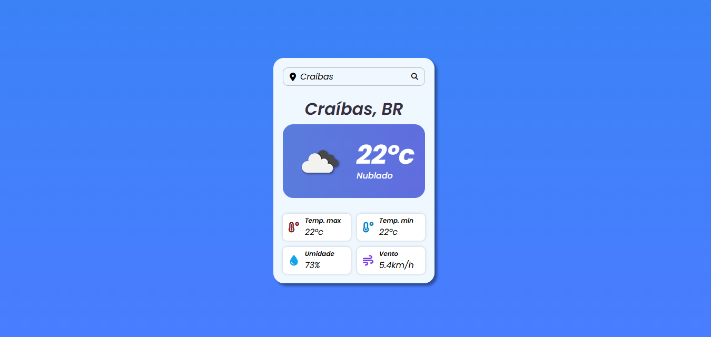

# Previsão do Tempo

Aplicação web para consultar as condições meteorológicas de uma cidade em tempo real.



## Vídeo de Demonstração


https://github.com/user-attachments/assets/f8d83ace-e679-4cb3-b90b-9aefd9e43e2a


## Funcionalidades

- Busca de previsão por nome da cidade
- Temperatura atual
- Temperatura máxima e mínima do dia local da cidade
- Descrição das condições meteorológicas
- Umidade relativa do ar
- Velocidade do vento em km/h
- Ícone representativo fornecido pela OpenWeather
- Mensagens de validação e erros da API
- Respostas em português brasileiro

O backend consulta simultaneamente os dados atuais e a previsão em intervalos de três horas da OpenWeather. As temperaturas máxima e mínima são calculadas pelo dia local da cidade consultada.

## Tecnologias

- **HTML5** — estrutura da interface
- **CSS3** — layout responsivo e estilização
- **JavaScript** — interação no navegador e chamadas à API
- **Node.js 20.6+** — servidor HTTP e proxy seguro para a API
- **OpenWeather API** — dados meteorológicos
- **Node.js Test Runner** — testes automatizados

Font Awesome, Google Fonts e os ícones da OpenWeather são usados como recursos visuais externos.

## Como executar

### Pré-requisitos

- Node.js 20.6 ou superior
- Uma chave da API da OpenWeather

### 1. Clone o projeto

```bash
git clone https://github.com/Paullo-Nunes/previsao.git
cd previsao
```

### 2. Configure a chave da API

Crie uma chave no painel da OpenWeather.

Copie o arquivo de exemplo e configure a variável:

```bash
cp .env.example .env
```

No Windows PowerShell, use:

```powershell
Copy-Item .env.example .env
```

Edite `.env` e substitua o valor de exemplo:

```env
OPENWEATHER_API_KEY=sua_chave_aqui
```

> Não envie o arquivo `.env` ou a chave da API para o repositório. O arquivo já está protegido pelo `.gitignore`.

### 3. Inicie o servidor

```bash
npm start
```

A aplicação ficará disponível em:

```text
http://localhost:3000
```

Digite o nome de uma cidade no campo de busca e pressione Enter ou clique no ícone de lupa.

## Endpoint da API

### `GET /api/weather`

Consulta os dados meteorológicos de uma cidade.

Exemplo:

```text
http://localhost:3000/api/weather?city=Recife
```

Resposta de exemplo:

```json
{
  "city": "Recife",
  "country": "BR",
  "temperature": 28,
  "temperatureMax": 30,
  "temperatureMin": 25,
  "forecastDate": "2026-01-15",
  "humidity": 70,
  "description": "nublado",
  "icon": "03d",
  "windSpeedKmh": 18
}
```

| Parâmetro | Descrição |
| --- | --- |
| `city` | Nome da cidade a pesquisar |

O servidor valida a entrada e as respostas recebidas da OpenWeather. Os principais códigos de retorno são `400`, `404`, `429`, `500`, `502` e `504`.

## Como o projeto funciona

O navegador envia a pesquisa para `/api/weather`. Em vez de incluir a chave da OpenWeather no frontend, o servidor Node.js realiza as consultas aos endpoints de clima atual e previsão. Depois valida os dados, calcula as temperaturas do dia e devolve um JSON simplificado para a interface.

Para melhorar o uso da API externa, o backend possui:

- Cache em memória por 5 minutos, limitado a 500 cidades
- Limite de 10 consultas por minuto por endereço IP
- Timeout de 8 segundos nas consultas externas
- Cabeçalhos de segurança e CSP
- Bloqueio de arquivos sensíveis no servidor estático

Esses controles são mantidos na memória do processo. Em uma hospedagem com várias instâncias, o cache e o limite de requisições devem ser compartilhados.

## Testes

Os testes utilizam respostas simuladas da OpenWeather e não exigem chave ou conexão externa.

```bash
npm test
```

Os testes cobrem a página inicial, endpoint meteorológico, cache, validação de entrada, limite de requisições, proteção de arquivos internos e ausência da chave da API na resposta.

## Estrutura do projeto

```text
.
├── index.html        # Interface da aplicação
├── style.css         # Estilos e layout
├── script.js         # Busca e atualização dos dados no navegador
├── server.js         # Servidor HTTP, API e integração com OpenWeather
├── server.test.js    # Testes automatizados
├── .env.example      # Modelo das variáveis de ambiente
├── images/           # Imagens e recursos visuais
└── package.json      # Metadados e scripts npm
```

## Publicação

O projeto precisa de hospedagem com suporte a Node.js. GitHub Pages não executa `server.js`, portanto não é suficiente para publicar o backend.

Em um provedor compatível:

1. Defina `OPENWEATHER_API_KEY` nas variáveis de ambiente.
2. Use `npm install` para instalar as dependências, embora este projeto não possua pacotes externos.
3. Configure o comando de inicialização como `npm start`.
4. Configure `PORT` quando exigido pela plataforma.

Não utilize uma chave exposta diretamente em arquivos HTML ou JavaScript.
